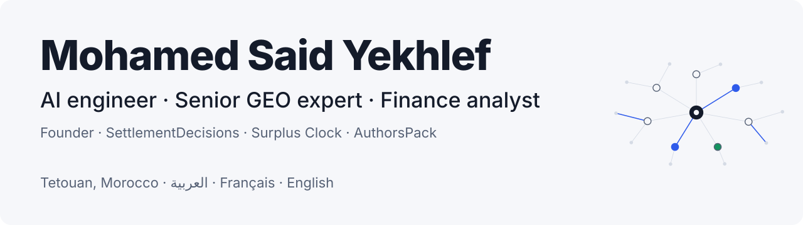
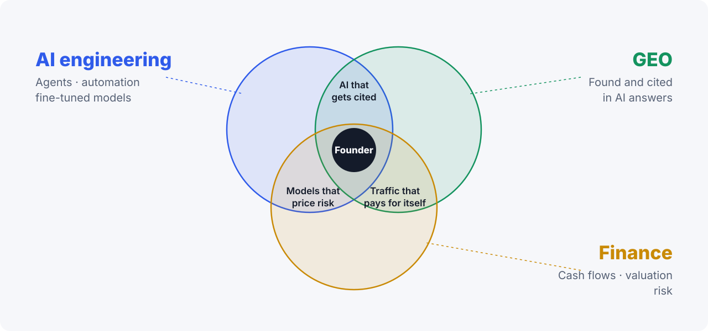
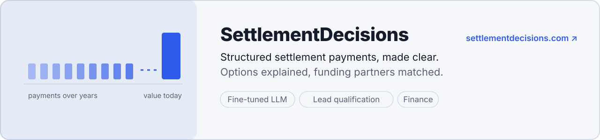
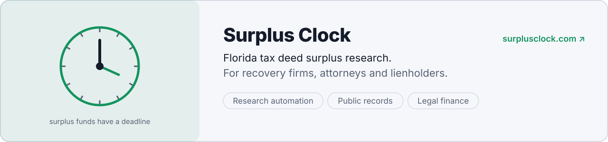
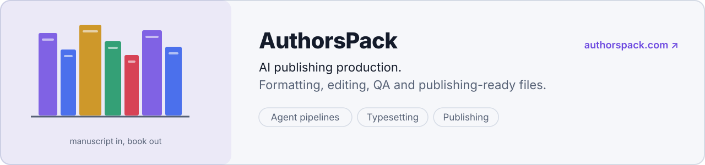
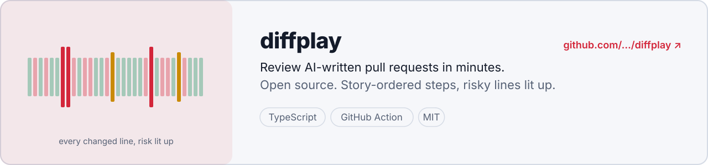

<picture>
  <source media="(prefers-color-scheme: dark)" srcset="assets/banner-dark.svg">
  
</picture>

  
  
  

I work where three skills meet: **building AI systems**, **getting businesses found in AI answers**, and **reading the numbers behind a decision**. Most founders have one and hire for the rest. Having all three is why my companies sit in fields where money and trust are on the line.

<picture>
  <source media="(prefers-color-scheme: dark)" srcset="assets/skills-dark.svg">
  
</picture>

 

## Companies I founded

<a href="https://settlementdecisions.com">
<picture>
  <source media="(prefers-color-scheme: dark)" srcset="assets/card-settlement-dark.svg">
  
</picture>
</a>

<a href="https://surplusclock.com">
<picture>
  <source media="(prefers-color-scheme: dark)" srcset="assets/card-surplus-dark.svg">
  
</picture>
</a>

<a href="https://authorspack.com">
<picture>
  <source media="(prefers-color-scheme: dark)" srcset="assets/card-authors-dark.svg">
  
</picture>
</a>

## Open source

<a href="https://github.com/mohamedsaidyekhlef-png/diffplay">
<picture>
  <source media="(prefers-color-scheme: dark)" srcset="assets/card-diffplay-dark.svg">
  
</picture>
</a>

 

## GEO field notes

What actually gets a brand cited by ChatGPT, Perplexity, Gemini and Google AI Overviews. Free, take them.

1. **Write things worth quoting.** The research that named the field ([GEO, KDD 2024](https://arxiv.org/abs/2311.09735)) found that adding citations, quotations and statistics raised visibility in AI answers by up to about 40%, while keyword stuffing did almost nothing.
2. **Answer in the first two sentences.** Engines lift short, self-contained passages. If the answer is in paragraph four, someone else's page gets quoted instead.
3. **Be where the models read.** Your own site is one source. Reviews, comparisons, forums and directories that mention you often decide whether you get recommended.
4. **Make the page easy to parse.** Clean headings, structured data and a plain-text summary help crawlers understand what you are and who you are for.
5. **Track prompts, not keywords.** Each month, ask the engines the questions your customers ask and record who gets named. That's the scoreboard that matters now.

## Before I build anything, I run the numbers

- **Who pays, how much, and when?** Revenue that arrives in 90 days is a different business from revenue that arrives today.
- **What does one customer cost to win, and how long until they pay it back?**
- **What breaks first in the bad case?** I model the downside before the upside.
- **Can every number in a recommendation be traced to its source?** If not, it doesn't ship.

 

## Stack

## Let's talk

Partnerships, investment, a brand that needs to show up in AI answers, or a decision that has to hold up to the numbers: **[connect on LinkedIn](https://www.linkedin.com/in/mohamed-said-yekhlef-476306216/)** or **[email me](mailto:mohamedsaidyekhlef@gmail.com)**. I work in English, French and Arabic.

