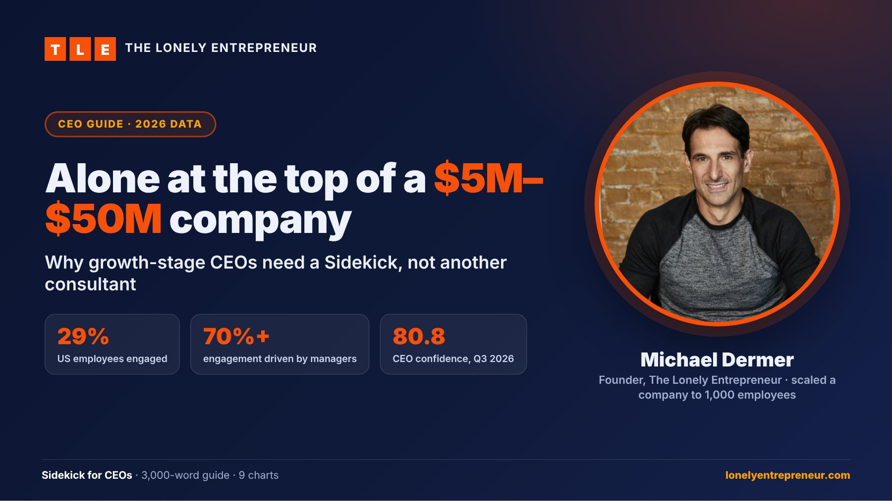
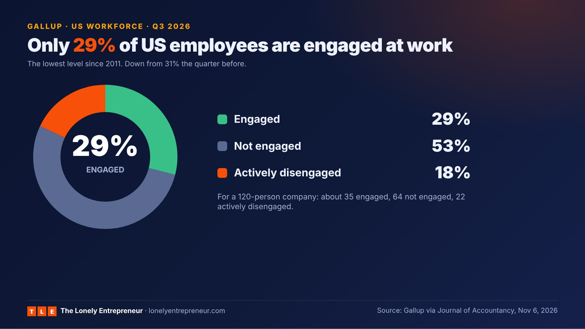
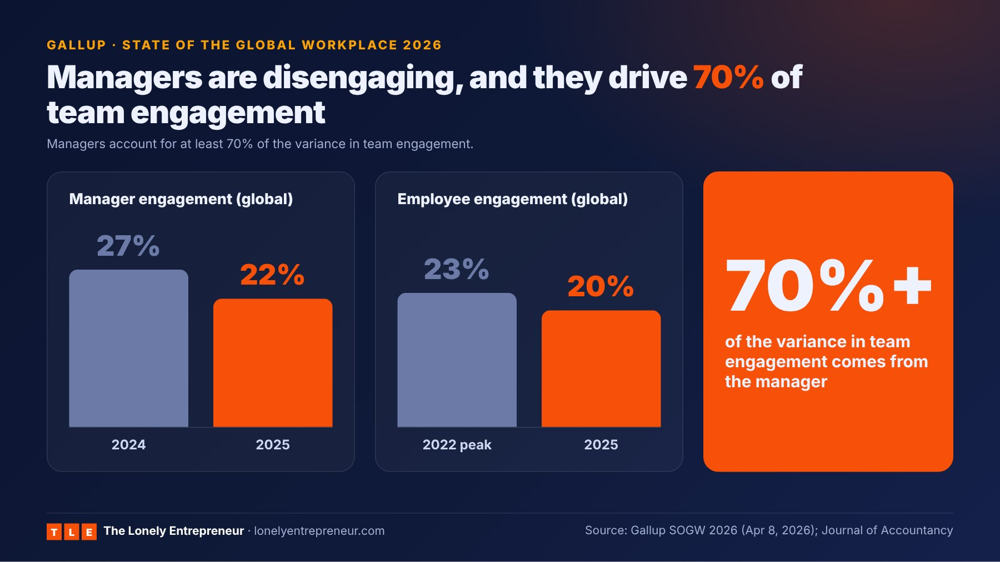
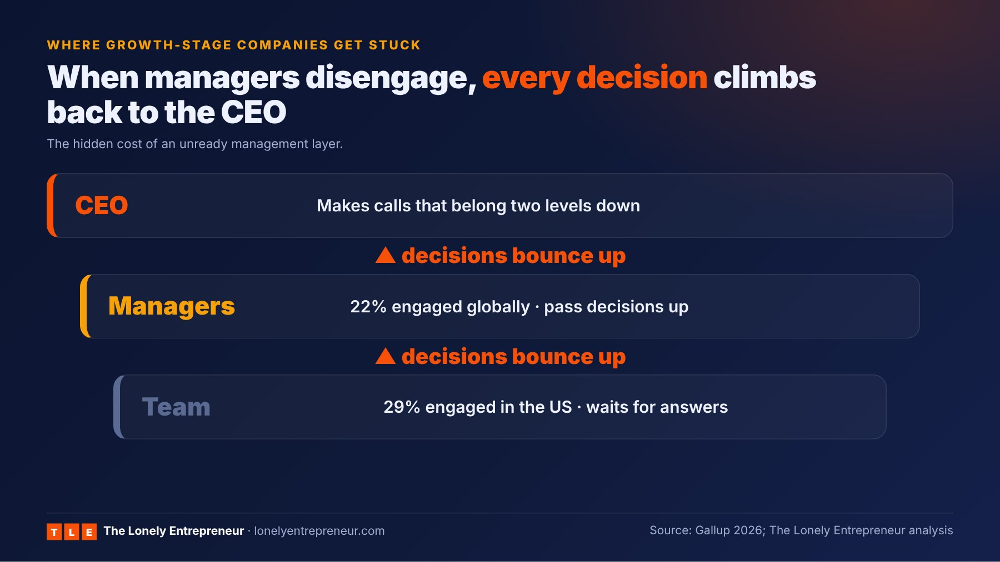
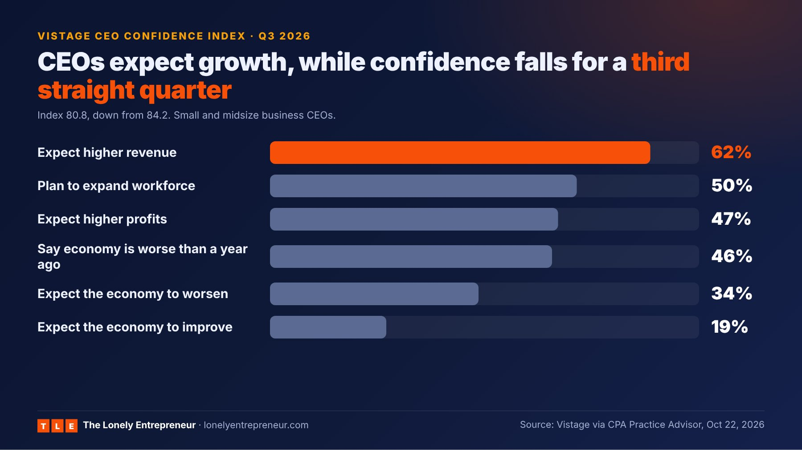
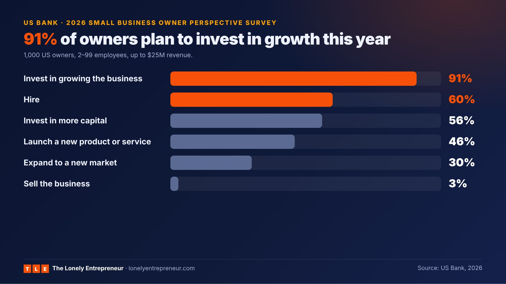
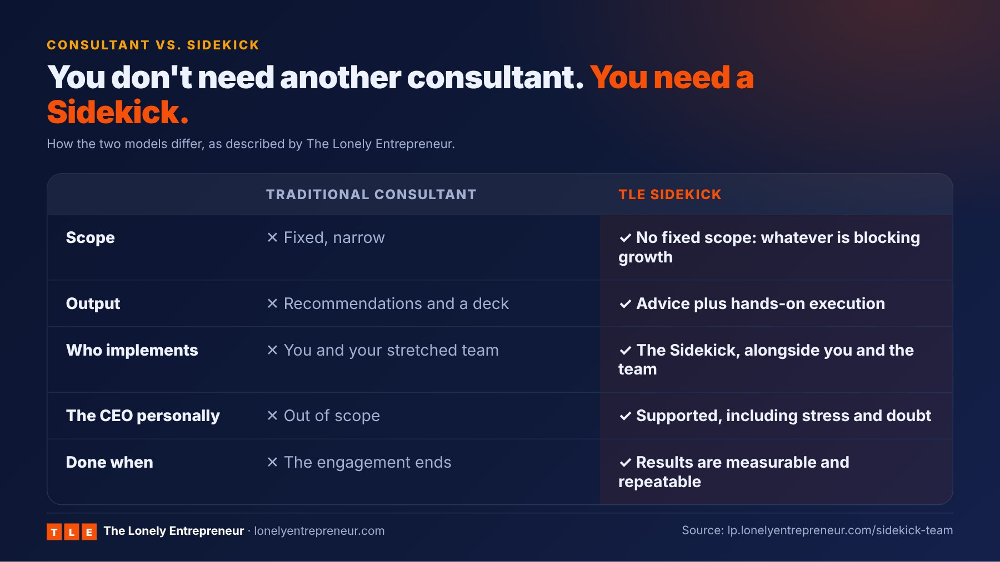
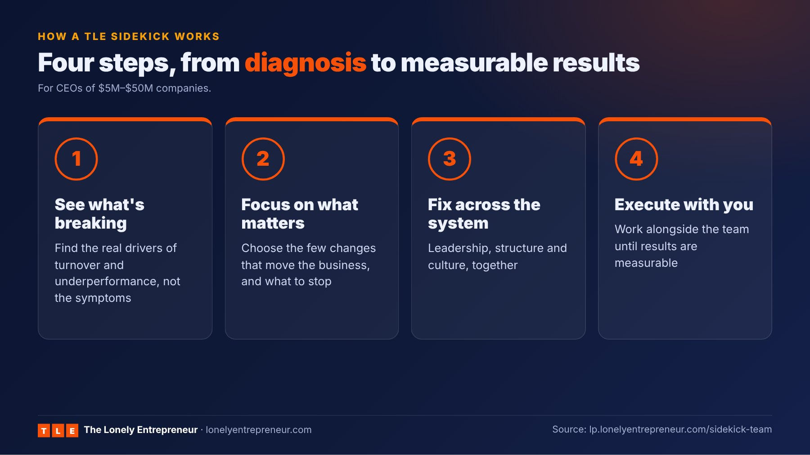
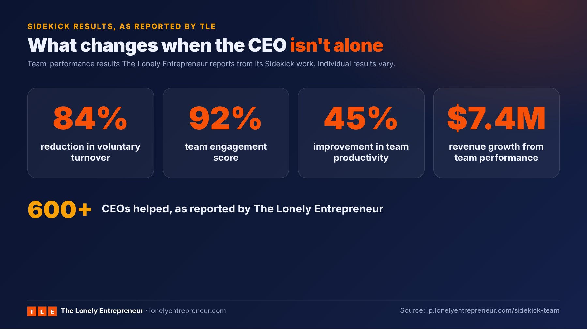
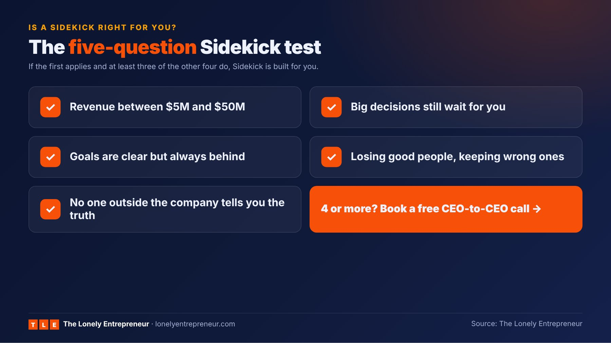

# Alone at the Top of a $5M–$50M Company: Why Growth-Stage CEOs Need a Sidekick, Not Another Consultant (2026)

*A 2026 data guide for founders and CEOs whose companies have outgrown the founder doing everything. By The Lonely Entrepreneur, with insights from Michael Dermer.*

**Quick answer:** A CEO Sidekick is a senior operator who has run a company before and works alongside a $5M–$50M CEO to find what is really holding the business back, decide which few changes matter most, and then help execute them with the team. Unlike a consultant, a Sidekick has no fixed scope and stays until results are measurable. [The Lonely Entrepreneur's Sidekick](https://lonelyentrepreneur.com/sidekick/?utm_source=vocal&utm_medium=syndication&utm_campaign=sidekick_guide_2026) is built for exactly this stage, led by founder Michael Dermer, who scaled a company to 1,000 employees and led it through the 2008 financial crisis.

## The 30-second version

- **US employee engagement fell to 29% in Q3 2026**, the lowest level since 2011. 18% of workers are actively disengaged ([Gallup, via Journal of Accountancy, Nov 2026](https://www.journalofaccountancy.com/news/2026/nov/u-s-employee-engagement-falls-below-30-for-first-time-in-15-years/)).
- **Managers account for at least 70% of the variance in team engagement**, and manager engagement itself fell from 27% to 22% in a single year ([Gallup State of the Global Workplace 2026](https://www.gallup.com/file/workplace/712607/SOGW_Global-Press-Release-2026-04.pdf)).
- **Small and midsize CEOs are losing confidence:** the Vistage CEO Confidence Index fell to 80.8 in Q3 2026, its third straight decline, yet 62% still expect higher revenue ([CPA Practice Advisor, Oct 2026](https://www.cpapracticeadvisor.com/2026/10/22/ceo-confidence-falls-for-third-straight-quarter/192215/)).
- **The gap between ambition and execution is a leadership problem**, and it lands on one person: the CEO. That is the job a Sidekick is designed to share.

---

## 1. The $5M–$50M squeeze: the stage nobody prepares you for

Most founders know how to start a company. Far fewer know how to run the one it turns into.

Somewhere between $5 million and $50 million in revenue, the business stops being a group of people around a founder and becomes an organization. There are managers now, and managers of managers. There are departments with their own goals. Decisions that used to happen in a hallway now happen in meetings, or don't happen at all. The founder who was once the company's greatest strength slowly becomes its bottleneck.

Michael Dermer, founder of [The Lonely Entrepreneur](https://lonelyentrepreneur.com/?utm_source=vocal&utm_medium=syndication&utm_campaign=sidekick_guide_2026), has lived this stage from the inside. He built a company in the health rewards industry, scaled it to 1,000 employees, led it through the 2008 financial crisis and eventually exited. Today he works directly with CEOs on the problems that show up at exactly this size: teams that don't execute, managers who aren't ready, cash that's always tighter than it should be, and a CEO who is carrying far too much alone.

> "You don't need another consultant. You need a Sidekick."
> — The Lonely Entrepreneur, Sidekick program

The numbers from 2026 explain why this stage feels so hard right now.

## 2. Your team is less engaged than at any point in 15 years

Gallup tracks employee engagement in the United States every quarter. In Q3 2026, **only 29% of US employees were engaged at work**, down from 31% the quarter before and the lowest level since 2011. Another 53% were not engaged, and 18% were actively disengaged.

For a $20M company with 120 employees, that profile means roughly 35 people who are fully committed, 64 who are doing what's asked and little more, and around 22 who are actively working against the culture. Gallup estimates that not-engaged and actively disengaged workers cost the US economy about **$2 trillion a year** in lost productivity.

The global picture is the same. Gallup's *State of the Global Workplace 2026*, released in April, found global engagement at **20% in 2025**, down from a 23% peak in 2022. Low engagement cost the world economy an estimated **$10 trillion** in lost productivity, about 9% of global GDP.

For a growth-stage CEO, this isn't an abstract trend. It's the reason the plan that looked so clear in January is three months behind in October.

## 3. The real problem is the middle of the org chart

The most important finding in Gallup's 2026 research isn't about frontline employees. It's about managers.

**Manager engagement fell from 27% in 2024 to 22% in 2025**, a five-point drop in a single year and nine points since 2022. And Gallup has found that **managers account for at least 70% of the variance in team engagement**.

That combination is the hidden crisis inside most $5M–$50M companies. The founder promoted loyal, capable people into management as the company grew. Those managers were never trained to lead. They are now stretched between the CEO's expectations and their team's frustrations, and their own engagement is falling.

When managers disengage, everything downstream slows: hiring decisions, performance conversations, accountability, follow-through. And every one of those problems eventually lands back on the CEO's desk.

This is why so many CEOs at this stage feel like they're doing everyone's job. In a sense, they are. The management layer that should be absorbing decisions is passing them up instead.

## 4. CEOs expect growth, but confidence is slipping

Vistage surveys CEOs of small and midsize businesses every quarter. Its CEO Confidence Index fell to **80.8 in Q3 2026**, down from 84.2 the quarter before and the third straight quarterly decline.

The details show a CEO class caught between ambition and anxiety:

- **46%** say US economic conditions are worse than a year ago, and only **19%** expect the economy to improve next year.
- Yet **62%** still expect higher revenue, and **47%** expect higher profits.
- **50%** plan to expand their workforce, and the top challenge they name is **finding and retaining qualified talent**.

That last point matters. When CEOs plan to grow while the talent market is tight and engagement is falling, the bottleneck isn't strategy. It's execution through people.

The US Bank 2026 Small Business Owner Perspective Survey tells the same story from a broader sample: **91% of owners plan to invest in growing their business** in the next 12 months, and **60% plan to hire** ([US Bank, 2026](https://www.usbank.com/business-banking/business-resource-center/small-business-survey.html)).

There's one more 2026 shift CEOs can't ignore. **82% of the CEOs Vistage surveyed now use generative AI**, up from 76% in Q4 2025. Gallup found that organizations combining frequent AI use, a clear AI strategy and active manager support reached **53% engagement**, far above the national average. Technology alone doesn't lift a team. Technology plus managers who know how to lead with it does, which brings the conversation straight back to leadership.

Ambition isn't the problem. Almost every owner wants to grow. The question is who helps the CEO turn that ambition into a team that executes.

## 5. Hiring won't save you on its own

When a team underperforms, the instinct is to hire. More people, better people, a new VP.

But the 2026 data shows the limits of that approach. In Gusto's *State of Small Business 2026*, **26% of owners tried to hire but struggled** to find qualified workers they could afford, and **64% of them blamed a skills gap** ([Gusto, Nov 2026](https://gusto.com/resources/gusto-insights/state-of-small-business-2026)). In Vistage's Q3 survey, talent was again the number-one challenge CEOs named.

Even when you can hire, a new person joins the same system that produced the problem. If roles are unclear, accountability is missing and middle managers are disengaged, the new hire inherits all of it. Within a year, many companies find themselves hiring for the same seat again.

The Lonely Entrepreneur's Sidekick team describes the root causes it sees most often in companies at this size:

- **Inside the company:** unclear roles, weak middle management, no accountability framework, cultural drift from rapid hiring, toxic performers who are protected because they produce, and a founder who still makes every decision.
- **Around the company:** uncompetitive compensation, no visible career path, hiring for skills over fit, poor onboarding, an unclear vision, and the wrong people in leadership seats.

Most of these are not hiring problems. They are leadership, structure and culture problems, and they have to be fixed together.

### The three signs your management layer is the bottleneck

You don't need an engagement survey to spot the problem. Look for these patterns over the last 90 days:

1. **Decisions bounce back up.** Managers bring you problems instead of recommendations, and you end up making calls that should be made two levels below you.
2. **The same conversation keeps happening.** A performance issue, a missed handoff or a conflict between departments gets "resolved" in a meeting and returns a month later.
3. **Your best people are quietly frustrated.** High performers leave, or stay and stop volunteering ideas, because they don't see accountability applied to everyone.

If two of these sound familiar, the issue isn't effort. It's the system your managers are working inside, and that system was designed, intentionally or not, by the CEO.

## 6. Why consultants don't fix this

When CEOs finally ask for outside help, they usually call a consultant. Consultants can be valuable. But for the problems above, the traditional model has three built-in limits:

1. **A narrow scope.** Consultants are hired to fix "the sales process" or "the org chart." The real issue usually crosses three or four of those boxes at once.
2. **Advice without execution.** The engagement ends with a deck and recommendations. The CEO and an already stretched team are left to implement them.
3. **They stay out of the personal side.** Consultants rarely touch the CEO's own stress, doubt or decision-making, even though those are often part of the problem.

A Sidekick is built around the opposite assumptions. There's no fixed scope, because the problem rarely fits in one. Advice comes with hands-on execution alongside the CEO and the team. And the CEO is supported personally, including the stress and doubt that come with the role.

## 7. How a TLE Sidekick works

[Sidekick](https://lonelyentrepreneur.com/sidekick/?utm_source=vocal&utm_medium=syndication&utm_campaign=sidekick_guide_2026) is The Lonely Entrepreneur's service for CEOs of companies with **$5 million to $50 million in revenue** who are facing stalled growth, missed goals, tight cash or teams that underperform. The work follows four steps.

**1. See what's really breaking.** The first step is diagnosis, not prescription. A Sidekick identifies the real drivers of turnover, underperformance or stalled growth, as opposed to the symptoms the CEO sees every day.

**2. Focus on what matters most.** Most companies at this size have 20 things they could fix. A Sidekick helps the CEO choose the few changes that will move the business, and just as importantly, what to stop doing.

**3. Fix across the system.** Leadership, structure and culture are addressed together, because fixing one while ignoring the others is why so many change efforts fade.

**4. Execute with you, and stay until it's measurable.** A Sidekick works alongside the CEO and the team to implement the changes, and stays until results are measurable and repeatable.

The outcomes CEOs come for are specific: grow revenue without adding chaos, turn marketing spend into measurable pipeline, improve margins without cutting growth, build teams that execute without constant oversight, and get clear on priorities.

## 8. What changes when the CEO isn't alone

On its Sidekick program page, The Lonely Entrepreneur reports that its work has helped **more than 600 CEOs**, and it shares the kind of team-performance results it has seen:

*Figures as reported by The Lonely Entrepreneur on its [Sidekick team performance page](https://lp.lonelyentrepreneur.com/sidekick-team?utm_source=vocal&utm_medium=syndication&utm_campaign=sidekick_guide_2026). Individual results vary by company.*

Two CEOs describe the experience in their own words on that page. A CEO of a $12 million company said they were losing their best people and couldn't figure out why. The problem turned out not to be pay itself but everything around it, and Sidekick helped them see the whole picture and rebuild. A CEO of a $10 million company said the issue wasn't effort but alignment, and that once the right things were fixed together, "everything started to move."

That's the core idea. Growth-stage companies rarely lack effort. They lack alignment, and the CEO can't create it alone.

## 9. The loneliness tax on CEO decisions

There's a reason the company is called The Lonely Entrepreneur. Running a company is one of the loneliest jobs there is, and it gets lonelier as the company grows.

At $2 million, the founder still sits next to the team. At $20 million, there are layers between the CEO and the people doing the work. Fewer people tell the CEO the truth. Every hard decision, about a co-founder, a struggling executive, a big customer or the company's cash, gets made with less honest input. TLE's own research on [leadership loneliness in 2026](https://lonelyentrepreneur.com/leadership-loneliness-epidemic-2026/?utm_source=vocal&utm_medium=syndication&utm_campaign=sidekick_guide_2026) and on [how isolation rises as founders scale](https://lonelyentrepreneur.com/founder-isolation-curve/?utm_source=vocal&utm_medium=syndication&utm_campaign=sidekick_guide_2026) explores why this happens.

A Sidekick changes that dynamic in a simple way: the CEO has a senior partner who has been in the seat, who has no internal politics, and who will say what nobody inside the company will. That's not therapy and it's not consulting. It's the peer-level counsel most CEOs at this size simply don't have.

## What the best growth-stage CEOs do differently

Whether or not you bring in a Sidekick, the CEOs who get through the $5M–$50M stage well tend to share a handful of habits:

- **They protect thinking time.** They block hours every week to work on the business rather than in it, and they treat that time as seriously as a customer meeting.
- **They invest in managers first.** Since managers drive at least 70% of the variance in team engagement, the highest-leverage training dollar goes to the management layer, not the front line.
- **They make accountability visible.** Clear owners, clear deadlines and a simple weekly review turn good intentions into follow-through.
- **They fix the system, not the symptom.** When turnover rises, they look at roles, management, compensation structure and culture together, instead of reaching for a single fix.
- **They don't decide alone.** They build a small circle of people who have been there before, and they let those people challenge them.

That last habit is the one most CEOs skip, and it's the one that makes all the others easier.

## 10. Is a Sidekick right for you? A five-question test

Answer honestly:

1. **Revenue:** Is your company between $5 million and $50 million in revenue?
2. **Bottleneck:** Do important decisions still wait for you, even with a management team in place?
3. **Execution:** Are your goals clear but consistently behind schedule?
4. **People:** Are you losing good people, or keeping people you know are wrong for their seats?
5. **Counsel:** When you face your hardest decisions, is there anyone outside the company you trust to tell you the truth?

Score one point for each yes to questions 1 to 4, and one point for a no to question 5. If question 1 is a yes and you score four or more, you are the CEO a Sidekick is built for.

## 11. The right next step for every stage

Not every founder needs a Sidekick yet. The Lonely Entrepreneur offers a clear path depending on where you are:

- **Not sure where you're exposed?** Start with [The Dermer Diagnosis](https://lonelyentrepreneur.com/dermer-diagnosis/?utm_source=vocal&utm_medium=syndication&utm_campaign=sidekick_guide_2026), a free 8-minute assessment that scores five areas of your business and shows what to fix first.
- **Running a $1M–$5M company?** [The Founder Blueprint](https://lonelyentrepreneur.com/founder-blueprint/?utm_source=vocal&utm_medium=syndication&utm_campaign=sidekick_guide_2026) is a five-week program across customers, team, money, the CEO role and AI, with five hours of one-on-one coaching ($2,500).
- **Want a community of founders who've been there?** [The Learning Community](https://lonelyentrepreneur.com/learning-community-2/?utm_source=vocal&utm_medium=syndication&utm_campaign=sidekick_guide_2026) offers 5,000+ learning modules, 400+ financing sources, group coaching and weekly live sessions with Michael ($999 a year, with a 30-day free trial).
- **Want AI working on your founder problems?** [AI Sidekick](https://lonelyentrepreneur.com/ai-sidekick/?utm_source=vocal&utm_medium=syndication&utm_campaign=sidekick_guide_2026) puts AI to work on the challenges you face every day.
- **Leading a $5M–$50M company?** [Sidekick](https://lonelyentrepreneur.com/sidekick/?utm_source=vocal&utm_medium=syndication&utm_campaign=sidekick_guide_2026) gives you a senior partner who has been in the CEO seat, with weekly check-ins, to build a business that runs without you. [See how Sidekick works](https://lonelyentrepreneur.com/sidekick-overview/?utm_source=vocal&utm_medium=syndication&utm_campaign=sidekick_guide_2026) or book a free 30-minute, CEO-to-CEO strategy call.

## Frequently asked questions

**What is a CEO Sidekick?**
A CEO Sidekick is a senior operator who has run a company and works directly with a CEO to identify what's holding the business back, prioritize the few changes that matter, and execute them with the team. TLE's Sidekick is designed for companies with $5M–$50M in revenue.

**How is a Sidekick different from a business consultant?**
Consultants usually work to a fixed scope and deliver recommendations. A Sidekick has no fixed scope, works hands-on alongside the CEO and team to implement changes, and supports the CEO personally, including stress and doubt.

**How is a Sidekick different from an executive coach?**
An executive coach typically focuses on the leader's own skills and behavior. A Sidekick does that and also works on the business itself: leadership, structure, culture and execution, until results are measurable.

**Why are so many growth-stage teams underperforming in 2026?**
US employee engagement fell to 29% in Q3 2026, the lowest since 2011, and manager engagement fell from 27% to 22% between 2024 and 2025. Since managers drive at least 70% of the variance in team engagement, weak middle management is often the root cause.

**Who is Michael Dermer?**
Michael Dermer is the founder of The Lonely Entrepreneur. He pioneered a category in health rewards, scaled a company to 1,000 employees, led it through the 2008 financial crisis and exited. He now works directly with CEOs on team performance, leadership, culture and structure.

**How do I get started with Sidekick?**
Book a free 30-minute strategy call through [The Lonely Entrepreneur's Sidekick page](https://lonelyentrepreneur.com/sidekick/?utm_source=vocal&utm_medium=syndication&utm_campaign=sidekick_guide_2026). It's CEO-to-CEO, with no commitment.

---

### Sources

- Gallup, *State of the Global Workplace 2026* press release (April 8, 2026): https://www.gallup.com/file/workplace/712607/SOGW_Global-Press-Release-2026-04.pdf
- Journal of Accountancy, "U.S. employee engagement falls below 30% for first time in 15 years" (Nov 6, 2026): https://www.journalofaccountancy.com/news/2026/nov/u-s-employee-engagement-falls-below-30-for-first-time-in-15-years/
- CPA Practice Advisor, "CEO Confidence Falls for Third Straight Quarter" (Vistage Q3 2026, Oct 22, 2026): https://www.cpapracticeadvisor.com/2026/10/22/ceo-confidence-falls-for-third-straight-quarter/192215/
- US Bank, 2026 Small Business Owner Perspective Survey: https://www.usbank.com/business-banking/business-resource-center/small-business-survey.html
- Gusto, State of Small Business 2026 (Nov 12, 2026): https://gusto.com/resources/gusto-insights/state-of-small-business-2026
- The Lonely Entrepreneur, Sidekick team performance page: https://lp.lonelyentrepreneur.com/sidekick-team

*This article is general education, not professional, legal or financial advice. Program details are as published by The Lonely Entrepreneur; confirm current terms on a strategy call.*

**The Lonely Entrepreneur** · [lonelyentrepreneur.com](https://lonelyentrepreneur.com/?utm_source=vocal&utm_medium=syndication&utm_campaign=sidekick_guide_2026) · Founder Michael Dermer
