# Stop Building Alone: Inside The Lonely Entrepreneur Learning Community (2026 Guide)

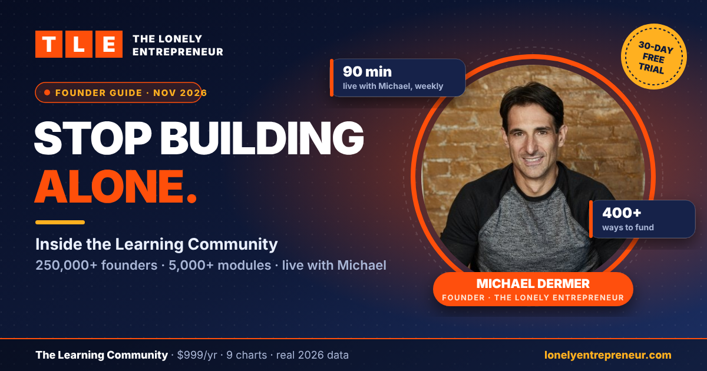

*Two-thirds of first-year owners feel lonely, and three in four say stress has hurt their work. **Michael Dermer built the Learning Community so no founder has to make the big decisions alone.** Here's what the data says, what's inside, what it costs and who it's for, in nine charts.*

**Quick answer:** The Lonely Entrepreneur Learning Community is a year-round membership for founders, mostly under $1M in revenue, that combines on-demand learning, live coaching, a peer community, funding sources and weekly live sessions with founder Michael Dermer, so owners stop making critical decisions alone. **The cost of building alone is paid in slower, worse decisions, and a room of founders is the cheapest fix there is.**

## The 30-second version

- **65%** of first-year owners feel lonely and **55%** wish they had someone to turn to for support (YouGov for the Start Up Loans Company).
- **74%** of owners say stress has hurt their work, and **28%** say it has delayed their decisions (Xero, 2026).
- The Learning Community includes **5,000+ modules**, **400+ ways to fund a business**, unlimited group coaching and **90 minutes live with Michael Dermer** every week.
- It costs **$999 a year** (about $2.74 a day) after a **30-day free trial** you can cancel at no cost.

It's 11 p.m. The house is quiet. You're at the kitchen table with a laptop, a spreadsheet and a decision that could change the next two years of your life: a hire you can't quite afford, a customer who hasn't paid, a lease, a loan, a partner who isn't pulling their weight. Your spouse is asleep. Your team thinks you have it handled. Your friends with regular jobs say "you'll figure it out."

Every founder knows this moment. **Almost none of them talk about it.** And that silence, more than any market or competitor, is what quietly breaks good businesses: decisions made alone, too late, with nobody to tell you what they would have done.

That's the problem Michael Dermer built The Lonely Entrepreneur to solve, and it's why the [Learning Community](https://lonelyentrepreneur.com/learning-community-2/?utm_source=github&utm_medium=post&utm_campaign=lc_guide_2026) is the service we point most founders to first. This guide shows what the 2026 data says about running a business alone, who Michael is and why he built this, exactly what's inside the membership, what it costs per day and per hour, who it's for and who it isn't for, and how to get the most out of the 30-day free trial.

> You don't need another course. You need a room full of people who have made the decision you're about to make.
>
> — The Lonely Entrepreneur · Founder Data Series

## The numbers behind founder isolation

Founder loneliness sounds like a feelings topic. The data says it's a business topic. Across several 2026 surveys of small business owners, the same pattern shows up: owners carry the weight alone, hide it from the people closest to them, and pay for it in worse and slower decisions.

Here is what that looks like across the surveys. Two-thirds of first-year owners report feeling lonely, more than half wish they had someone to turn to, and four in ten have considered walking away from the business entirely.

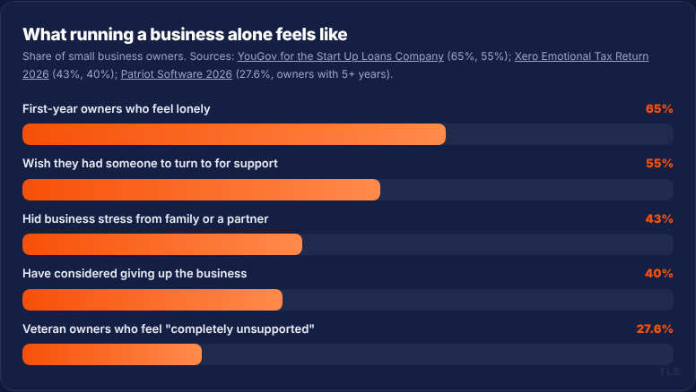

What running a business alone feels like. Share of small business owners. Sources: [YouGov for the Start Up Loans Company](https://www.startuploans.co.uk/media-centre/almost-half-uk-smaller-business-leaders-feel-isolated-running-their-business) (65%, 55%); [Xero Emotional Tax Return 2026](https://cpapracticeadvisor.com/2026/02/12/small-business-owners-lose-33-workdays-a-year-to-tax-and-financial-stress-xero-study-finds/177978) (43%, 40%); [Patriot Software 2026](https://www.patriotsoftware.com/blog/accounting/small-business-owner-burnout-survey/) (27.6%, owners with 5+ years).

Notice the last line. Even owners who have been in business five years or more aren't immune: **27.6% of veteran owners say they feel completely unsupported**, according to Patriot Software's 2026 survey. Experience makes the work easier. It doesn't make it less lonely. If anything, the longer you run a company, the fewer people there are who understand what you're carrying.

And 43% have hidden business stress from their family or partner. That number matters, because the people at home are usually the founder's last line of support. When the stress goes underground there too, the founder is truly on their own.

## Why it's a business problem, not a feelings problem

Start with sleep, because everything else depends on it. Patriot Software found new owners are more than twice as likely as veteran owners to lose sleep almost every night.

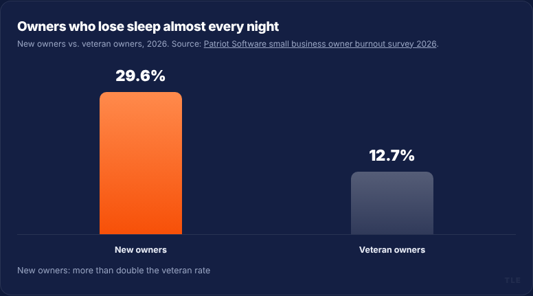

Owners who lose sleep almost every night. New owners vs. veteran owners, 2026. Source: [Patriot Software small business owner burnout survey 2026](https://www.patriotsoftware.com/blog/accounting/small-business-owner-burnout-survey/).

A founder who doesn't sleep makes worse calls on pricing, hiring and cash. That's not a motivational-poster idea; it's the most predictable cost in business. And it compounds: tired founders avoid hard conversations, delay decisions and default to whatever feels safest tonight rather than what's smartest for next year.

Xero's 2026 research puts a number on it. Three in four owners say stress has negatively affected their work, and more than a quarter say it has delayed their decisions.

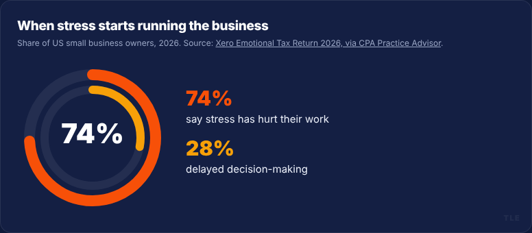

When stress starts running the business. Share of US small business owners, 2026. Source: [Xero Emotional Tax Return 2026, via CPA Practice Advisor](https://cpapracticeadvisor.com/2026/02/12/small-business-owners-lose-33-workdays-a-year-to-tax-and-financial-stress-xero-study-finds/177978).

And the damage isn't abstract. Owners name what stress actually cost them.

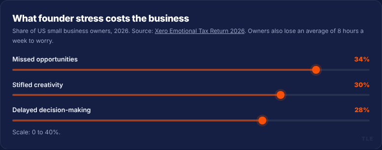

What founder stress costs the business. Share of US small business owners, 2026. Source: [Xero Emotional Tax Return 2026](https://cpapracticeadvisor.com/2026/02/12/small-business-owners-lose-33-workdays-a-year-to-tax-and-financial-stress-xero-study-finds/177978). Owners also lose an average of 8 hours a week to worry.

> **Isolation doesn't show up on the P&L. Its effects show up everywhere else on it.**

Put those numbers together and the picture is clear. The cost of building alone isn't mainly emotional. It's missed opportunities, slow decisions, blind spots on pricing and cash, and mistakes that someone a few years ahead of you would have spotted in five minutes. That's the gap a founder community exists to close.

## Meet Michael Dermer: why he built this

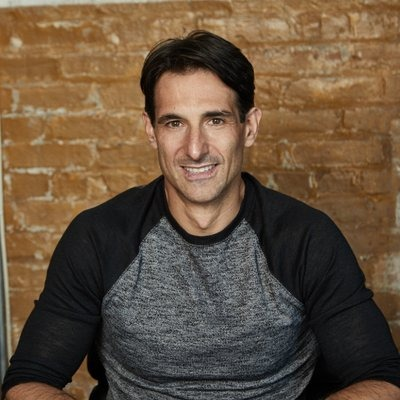

**Michael Dermer**, founder of The Lonely Entrepreneur. Two-time Academic All-American and former attorney at Willkie Farr & Gallagher. Built IncentOne to 1,000 employees over ten years, watched a decade of work nearly disappear in ten days during the 2008 collapse, and went on to a successful exit. Today he hosts a 90-minute live session for Learning Community members every week.

Michael didn't come to entrepreneurship from a classroom. He left a career at one of New York's big law firms to build a company, and spent ten years growing IncentOne to 1,000 employees. Then 2008 happened. By his own account, a decade of work came close to disappearing in ten days. He came through it and later achieved a successful exit, but the lesson he took from those years wasn't about markets. It was about how alone he had felt making the decisions that mattered most.

Founders get plenty of information. There are books, podcasts, courses and an endless feed of advice. What they rarely get is **honest input from people who have been in the same seat and have nothing to sell them**. Bankers want to lend. Brokers want a commission. Consultants want the next project. Michael built The Lonely Entrepreneur around the opposite idea: a place where founders could get real answers from people who have lived it, without anyone angling for a cut.

That's also why he still shows up live every week. The Learning Community isn't a library he recorded once and walked away from. It's a room he's in.

## What the Learning Community actually is

The Learning Community describes itself as a "home base," not a course. It's organized around six pillars of support, each built for a different kind of founder problem.

- **Knowledge:** 5,000+ on-demand modules on strategy, growth, leadership, hiring, marketing, finance and operations, with guidance for 50+ industries.
- **On-demand help:** Entrepreneur Success Managers for real-time answers, unlimited live group coaching and 90 minutes live with Michael every week.
- **Tools and vendor reviews:** Free templates for plans, agreements and checklists, prescreened vendor reviews from founders, and negotiated discounts.
- **Community:** An active network of founders, built to end isolation, with discussions that are about helping, not pitching.
- **Financing sources:** 400+ ways to fund a business: grants and government programs, angel and venture sources, revenue-based financing, crowdfunding and microloans.
- **AI:** AI Foundations education and an AI Vulnerability Score that shows where your business is exposed.

Here is the membership in four numbers.

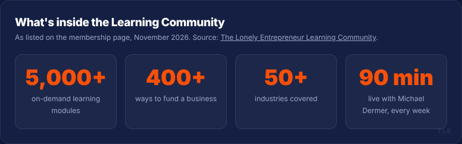

What's inside the Learning Community. As listed on the membership page, November 2026. Source: [The Lonely Entrepreneur Learning Community](https://lonelyentrepreneur.com/learning-community-2/?utm_source=github&utm_medium=post&utm_campaign=lc_guide_2026).

The breadth matters less than the combination. Most founder resources give you one of these things: content, or coaching, or community, or a list of lenders. The point of the Learning Community is that the module you watch on Tuesday becomes the question you ask in group coaching on Wednesday and the conversation you have with another founder on Thursday. Information turns into a decision because there are people around it.

## Why a room beats a course

There's a reason the community piece is the heart of it. When founders learn that other leaders share their experiences, most of them feel more connected.

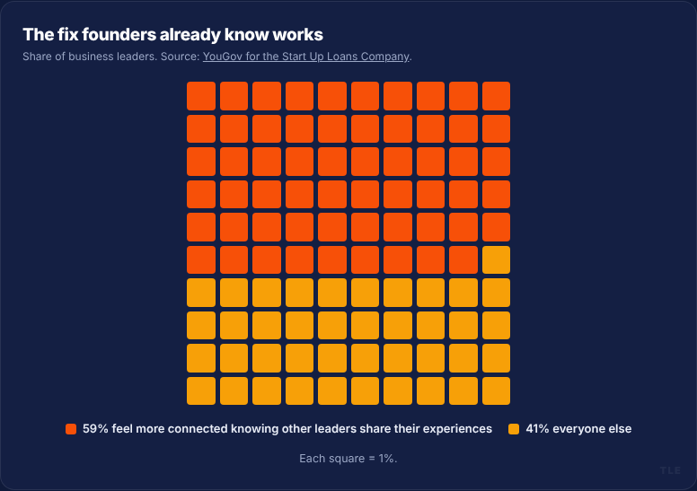

The fix founders already know works. Share of business leaders. Source: [YouGov for the Start Up Loans Company](https://www.startuploans.co.uk/media-centre/almost-half-uk-smaller-business-leaders-feel-isolated-running-their-business).

Courses are built to be finished. Businesses aren't. The problems a founder faces in month three, year three and year ten are different, and no fixed curriculum anticipates them all. A room adapts. When cash gets tight, someone in the room has been there. When the first big hire goes wrong, someone has made that mistake too, and can tell you what they'd do differently.

Founders are clearly hunting for trusted input. TD Bank's survey found the share of owners considering hiring a financial adviser nearly doubled in a year, while 40% say trusted advice has been hard to find.

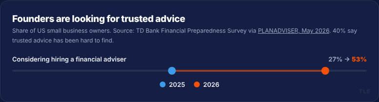

Founders are looking for trusted advice. Share of US small business owners. Source: TD Bank Financial Preparedness Survey via [PLANADVISER, May 2026](https://www.planadviser.com/many-small-business-owners-lack-financial-safety-net/). 40% say trusted advice has been hard to find.

That's the opening the Learning Community fills. Not one more expert with an incentive attached, but a standing group of peers and coaches whose only job is to help you decide well. The Learning Community page puts it plainly: guidance comes from experienced entrepreneurs, not AI responses.

> **Courses end. Businesses don't. Founders need a place to keep coming back to.**

## The value math

The Learning Community is priced at $999 a year, after a 30-day free trial. Here's where that sits among TLE's published services.

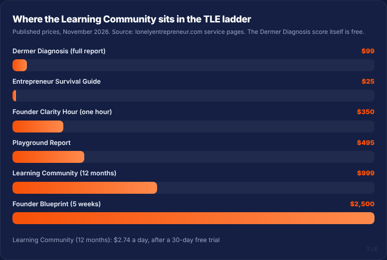

Where the Learning Community sits in the TLE ladder. Published prices, November 2026. Source: lonelyentrepreneur.com service pages. The Dermer Diagnosis score itself is free.

Broken down, $999 a year is about **$2.74 a day**, less than most founders spend on coffee. The more useful comparison is time with experienced people. The weekly 90-minute session with Michael alone adds up to 78 hours a year.

Compare the cost of an hour with a senior founder in a one-on-one session with the cost per hour of the live sessions inside the membership.

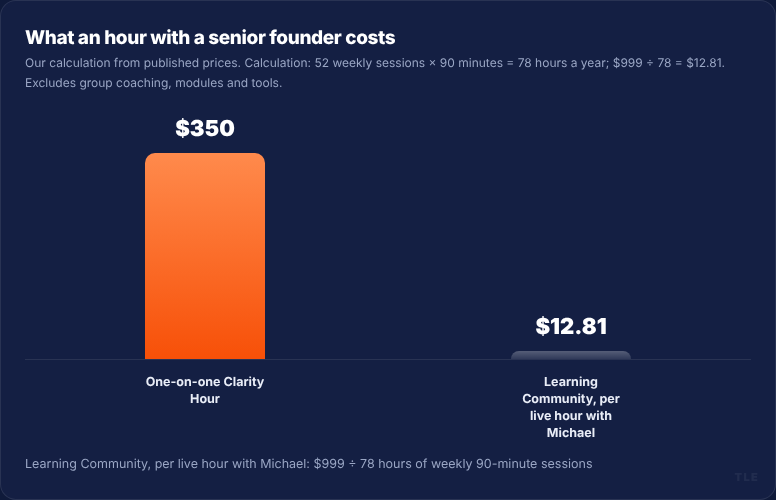

What an hour with a senior founder costs. Our calculation from published prices. Calculation: 52 weekly sessions × 90 minutes = 78 hours a year; $999 ÷ 78 = $12.81. Excludes group coaching, modules and tools.

To be fair to both options: a one-on-one hour is focused entirely on your problem, and that's exactly why TLE offers the [Founder Clarity Hour](https://lp.lonelyentrepreneur.com/clarity?utm_source=github&utm_medium=post&utm_campaign=lc_guide_2026) for a single big decision. The Learning Community is a different tool, an always-on room for the hundred smaller decisions that pile up every month. The page notes that coaching programs and masterminds typically cost thousands of dollars for a few months; the Learning Community is designed to be more affordable and ongoing. Most founders get the most value by starting there and adding one-on-one help only when a specific decision calls for it.

## Who it's for, and who it isn't

The Lonely Entrepreneur is direct about fit. Its rule of thumb: **under $1M in revenue, join the Learning Community; over $1M, look at a Sidekick.**

### Built for you if…

- You're pre-revenue or under $1M and making most decisions alone
- You want ongoing answers, not a one-time course
- You're looking for funding options and don't know where to start
- You want to learn from founders who have nothing to sell you
- You're a founder from a group that's often overlooked; there's content built for women, minority and veteran entrepreneurs

### Not for you if…

- You want a one-time course and a certificate
- You're looking for quick hacks or generic advice
- You're past $1M and need a senior partner one-on-one (see [Sidekick](https://lonelyentrepreneur.com/sidekick-overview/?utm_source=github&utm_medium=post&utm_campaign=lc_guide_2026))
- You want someone to run the business for you

If you're between $1M and $5M and want a structured plan, the [Founder Blueprint](https://lonelyentrepreneur.com/founder-blueprint/?utm_source=github&utm_medium=post&utm_campaign=lc_guide_2026) is five weeks of work across customers, team, money, the CEO role and AI, with five hours of one-on-one coaching. And if you're not sure where you stand at all, start with the free [Dermer Diagnosis](https://lonelyentrepreneur.com/dermer-diagnosis/?utm_source=github&utm_medium=post&utm_campaign=lc_guide_2026), which scores your business across five areas in about eight minutes.

## What members say

The testimonials on the membership page come from founders running businesses of different sizes, and they keep circling the same themes. A founder of a $3.1M services company described jumping between several resources every week, and said having one place changed how they make decisions. A founder of a $7.6M company said the biggest value was being connected to other founders facing the same problems. A founder of a $2.4M business valued having somewhere to ask questions and get perspective before making a mistake.

> "I wish I found you a year ago. I wasted so much time and money."
>
> — Learning Community member

It's a regret a lot of founders share, and the reason this guide exists. The cost of joining is visible. The cost of the year you spent figuring it out alone usually isn't, until you look back.

## How to get the most from your 30-day free trial

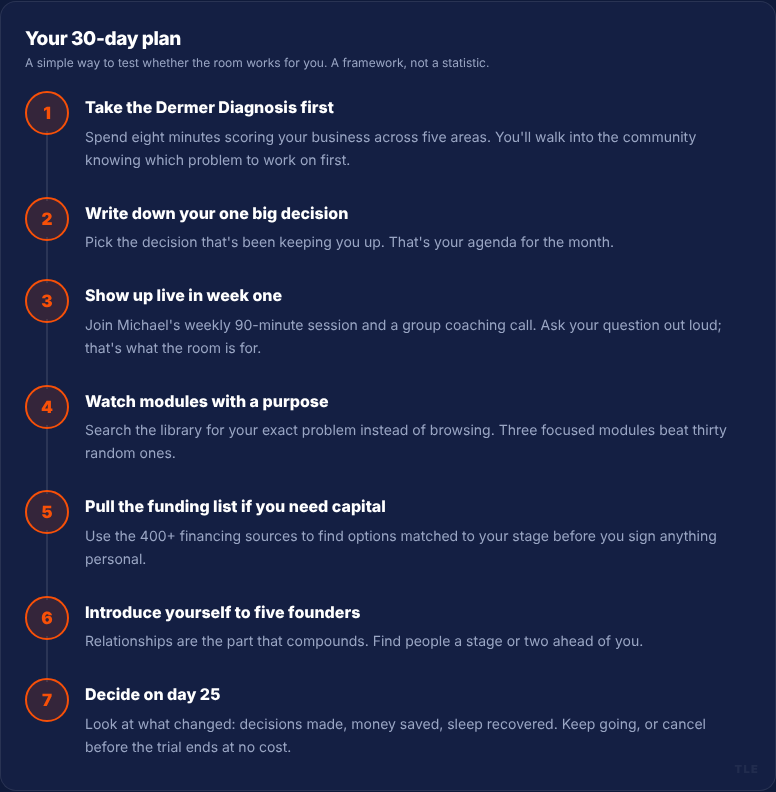

Your 30-day plan. A simple way to test whether the room works for you. A framework, not a statistic.

The trial is genuinely free: you can cancel before it ends and you won't be charged. If you stay, you're billed $999 for twelve months of full access. There's no catch beyond that, and no money-back guarantee is stated after billing, so use the 30 days properly.

[Start your 30-day free trial ›](https://lonelyentrepreneur.com/learning-community-2/?utm_source=github&utm_medium=post&utm_campaign=lc_guide_2026)

> **You built the business alone because you had to. You don't have to keep running it that way.**

## Frequently asked questions

### What is The Lonely Entrepreneur Learning Community?

A year-round membership for founders that combines 5,000+ on-demand learning modules, unlimited live group coaching, a peer community, 400+ financing sources, tools and vendor reviews, AI education and a weekly 90-minute live session with founder Michael Dermer.

### How much does the Learning Community cost?

$999 a year after a 30-day free trial. You can cancel before the trial ends at no cost. That works out to about $2.74 a day.

### Who is the Learning Community for?

Founders who want ongoing answers and support, especially those under $1M in revenue. Founders over $1M are pointed to TLE's Sidekick program. It isn't designed for people seeking one-time courses or quick hacks.

### Who is Michael Dermer?

The founder of The Lonely Entrepreneur. A two-time Academic All-American and former Willkie Farr & Gallagher attorney, he built IncentOne to 1,000 employees over ten years, came through the 2008 collapse and achieved a successful exit. He hosts a weekly live session for members.

### How common is loneliness among small business owners?

Very common. 65% of first-year owners report feeling lonely and 55% wish they had someone to turn to for support, according to YouGov research for the Start Up Loans Company. 43% have hidden business stress from family, per Xero's 2026 research.

### Is the Learning Community a course?

No. It describes itself as a "home base" rather than a course: an ongoing place to learn, ask questions, find funding and connect with other founders as the business changes.

## Sources

- [The Lonely Entrepreneur Learning Community](https://lonelyentrepreneur.com/learning-community-2/?utm_source=github&utm_medium=post&utm_campaign=lc_guide_2026)
- [YouGov for the Start Up Loans Company: UK smaller business leaders feel isolated](https://www.startuploans.co.uk/media-centre/almost-half-uk-smaller-business-leaders-feel-isolated-running-their-business)
- [Patriot Software small business owner burnout survey 2026](https://www.patriotsoftware.com/blog/accounting/small-business-owner-burnout-survey/)
- [Xero Emotional Tax Return 2026, via CPA Practice Advisor](https://cpapracticeadvisor.com/2026/02/12/small-business-owners-lose-33-workdays-a-year-to-tax-and-financial-stress-xero-study-finds/177978)
- [TD Bank Financial Preparedness Survey via PLANADVISER](https://www.planadviser.com/many-small-business-owners-lack-financial-safety-net/)

**Ready to stop building alone?** [Start your 30-day free trial of the Learning Community](https://lonelyentrepreneur.com/learning-community-2/?utm_source=github&utm_medium=post&utm_campaign=lc_guide_2026), or take the free [Dermer Diagnosis](https://lonelyentrepreneur.com/dermer-diagnosis/?utm_source=github&utm_medium=post&utm_campaign=lc_guide_2026) first.